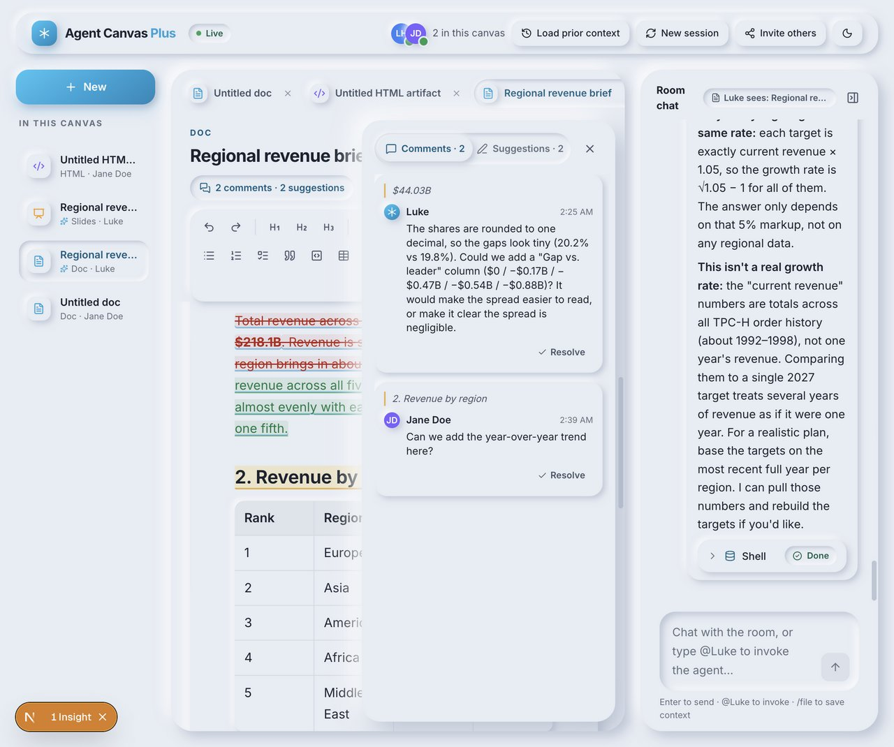

# Agent Canvas Plus (Co-CoCo): Multiplayer docs, slides, and artifacts with an agent, in Snowflake



A fork of [Agent Canvas](https://github.com/Snowflake-Labs/snowflake-multiplayer-ai-canvas). The original is a shared chat room with a Cortex Agent. This fork adds the things a team actually builds in that room: **documents, slide decks, and artifacts** that everyone edits live, with comments, tracked suggestions, autosave, and version history. The agent, **Luke**, can write and review those documents, run Python, and propose SQL writes that only run after a teammate approves them. Everything runs in Snowflake, next to the data.

## What's new in Plus

| Area | What you get |
| --- | --- |
| Live co-editing | Rich docs and slide decks (TipTap + Yjs), live cursors with names, presence avatars per doc |
| Artifacts | HTML (sandboxed live preview), Markdown, and Vega-Lite charts, co-edited in CodeMirror. **Pin to canvas** turns any chart Luke draws into an editable chart artifact |
| Slides | Write a deck in one flow (`---` starts a new slide), thumbnail rail, full-screen **Present** mode |
| Classic editor | Headings, lists, checklists, quotes, code blocks, tables, images, links, highlight, alignment, undo/redo, `/` slash menu, selection bubble menu |
| Comments | Anchored to text, threaded replies, resolve/reopen, live for everyone. Luke can comment too |
| Suggest mode | Toggle **Suggesting**: your insertions and deletions are tracked with your name for others to accept or reject. **Luke suggests** (on by default) makes Luke's edits arrive the same way |
| Ask Luke | Select text: improve, shorten, expand, fix, bulletize, or a custom instruction. `/` → *Ask Luke to write…* drafts at the cursor |
| Autosave + history | Edits save to Snowflake within ~1.5 s; a snapshot is kept at most once a minute; restore any snapshot |
| Luke's write tools | `create_document`, `edit_document` (as suggestions), `comment_on_document`, `read_document`, `list_documents`, `propose_sql` (approval-gated), `describe_sandbox`, `code_execution` |
| Look | Neumorphic UI in light and dark |
| Co-CoCo | The Cortex Code penguin is the logo, favicon, and Luke's avatar. A sledding CoCo is the loader, penguin illustrations fill the empty states, and doc kinds get pixel icons |

## How Luke's write tools work

Luke is a Cortex Agent called through the [Cortex Agent SDK](https://www.npmjs.com/package/@snowflake/cortex-agent-sdk). Its document tools are thin Snowflake procedures that log the call to `AI_OPS` and acknowledge it. The real change happens in the app: the server watches Luke's event stream, and when a `tool_use` arrives it creates the document, queues the edit for the open editors, or records the SQL proposal. That keeps every document a single collaborative source of truth instead of something the agent overwrites.

- **Edits and comments** are queued per document. The first open editor claims each one and applies it as tracked suggestions attributed to Luke; the Yjs sync carries it to everyone else. If nobody has the document open, the edit waits.
- **`propose_sql` never runs anything.** It stores the statement in `PENDING_ACTIONS` and shows an approval card to the whole room. **Approve & run** executes it (deployed: under the approver's own role via caller's rights; local dev: the dev service user's role), and the result or error posts back to the room. Account, role, user, and grant statements are blocked, and only one statement runs per approval.
- **`code_execution`** is Snowflake's sandboxed Python tool with `permission_policy: always_ask`. When Snowflake decides a call needs approval, the turn pauses and the room sees an approval card; the decision resumes the turn.

## Prerequisites

- A Snowflake account with Cortex Agents enabled, and a role that can run `setup.sql` as ACCOUNTADMIN
- The [Snowflake CLI](https://docs.snowflake.com/en/developer-guide/snowflake-cli-v2/index) (`snow`) with a configured connection
- Node.js 22+

## Run it locally (two teammates in two tabs)

```sh
npm ci

# Creates every Snowflake object (setup.sql), a key-pair SERVICE user that local
# dev signs in as (CANVAS_PLUS_DEV_SVC, granted only AGENT_CANVAS_PLUS_ROLE),
# and writes .env.local. Your own user is not changed.
scripts/provision-dev.sh <your-snow-connection>

npx next dev -p 3021
```

Open `http://localhost:3021/canvas?as=Ana` in one tab and `http://localhost:3021/canvas?as=Ben` in another. `?as=` is a local-dev-only identity switch; it is ignored when deployed, where identity comes from Snowflake login.

## Deploy to Snowflake App Runtime

```sh
snow sql -f setup.sql   # idempotent; re-run after changing tools or tables
snow app deploy
```

Open the printed URL and use **Invite others**. The service bills while running and auto-suspends after 15 minutes idle.

## Known limits

- **Single container** (`max_instances: 1`). Chat events and live document state are held in memory and persisted to Snowflake; scaling out needs a shared channel.
- **Suggest mode is intentionally simple.** Typing, deleting, and pasting are tracked. Formatting changes, new paragraphs (Enter), and table structure edits apply directly. Code artifacts don't have suggest mode; Luke edits them directly.
- **Luke's edits apply in the browser.** An edit waits until someone has that document open; it then lands as a suggestion for everyone.
- **Comments on artifacts** are document-level, not anchored to a line.
- **Agent calls run under the app role** (`AGENT_CANVAS_PLUS_ROLE`), as in the original. Only approved SQL runs under the approver's role, and only when deployed.
- **Code execution approval** depends on Snowflake classifying a call as state-changing. Pure computation runs without a prompt.
- One canvas (`main`) in the stock UI; `/canvas/<id>` works for others.

## How it's organized

```
├── setup.sql                    # Every Snowflake object, idempotent (tables, tools, agent, grants)
├── scripts/provision-dev.sh     # Local dev: run setup + create key-pair dev user + .env.local
├── app.yml                      # SPCS service manifest
└── src/
    ├── app/api/
    │   ├── canvas/[id]/         # send, stream, docs, actions, permission, file, load-context, …
    │   ├── docs/[docId]/        # sync (Yjs over SSE + POST), claim, snapshot, versions, comments
    │   ├── actions/[actionId]/  # approve / reject proposed SQL
    │   └── ai/transform/        # inline Ask Luke (AI_COMPLETE)
    ├── components/workspace/    # CanvasShell, DocRail, Workspace tabs
    ├── editor/                  # RichEditor, CodeArtifactEditor, suggest mode, comments, slides, history
    └── lib/                     # agent-turn (tool handling), doc-hub (live docs), docs-store, y-provider, …
```

## License

Apache 2.0. Based on [snowflake-multiplayer-ai-canvas](https://github.com/Snowflake-Labs/snowflake-multiplayer-ai-canvas) by Gilberto Hernandez.
